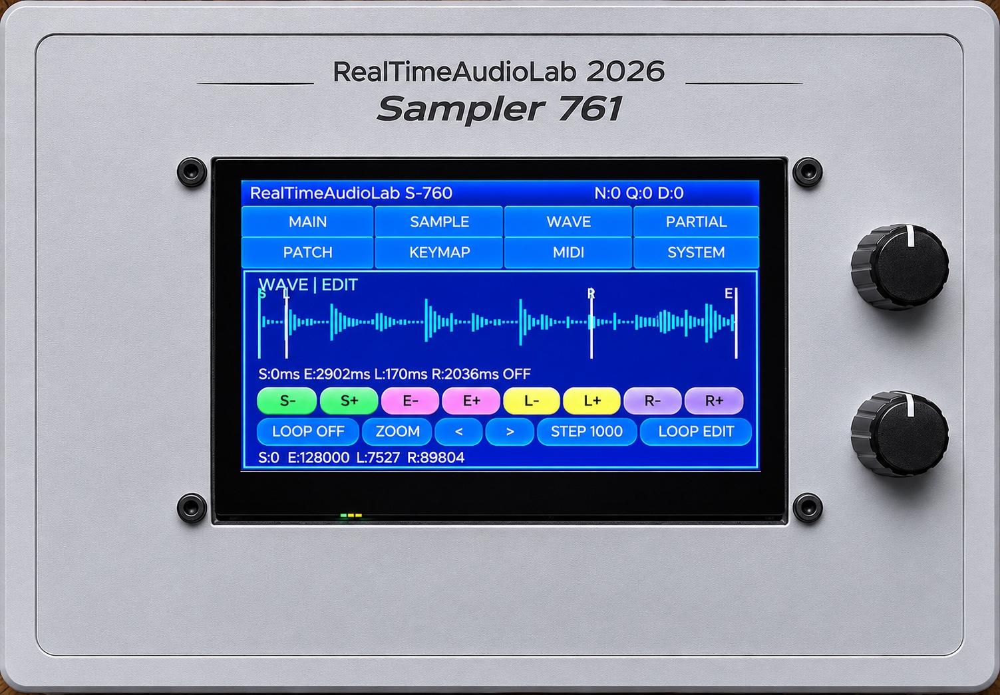
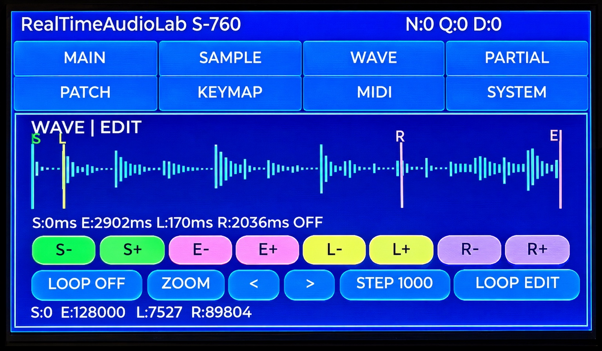

# RTAL-EAI-017-SoundSampler761

### RealTimeAudioLab · Embedded Sound Sampler · 2026

**An independent hardware sampler inspired by the workflow and creative spirit of the Roland S-760 — not a replica.**

> **PROJECT PREVIEW / WORK IN PROGRESS** — Active development. This repository is a project teaser, not a finished firmware release.

[Deutsch](README_DE.md) · [Roadmap](docs/ROADMAP.md) · [Technical overview](docs/TECHNICAL_OVERVIEW.md) · [Status](docs/DEVELOPMENT_STATUS.md)

## What is SoundSampler761?

**RTAL-EAI-017-SoundSampler761** is RealTimeAudioLab's standalone embedded sampler project, developed around an ESP32-S3 and a dedicated touchscreen interface. It draws inspiration from the hands-on sample editing, keymapping and patch architecture of classic rack samplers such as the Roland S-760, while implementing its own hardware, user interface and software architecture.

**No affiliation:** Roland and S-760 are trademarks/names of their respective owners. This project is not endorsed by, affiliated with or based on proprietary Roland firmware, ROMs, sample libraries or artwork.

## Prototype gallery

| Hardware prototype | Touchscreen wave editor |
|:--:|:--:|
|  |  |

The photographs document the current prototype. The enclosure carries the project label **Sampler 761**; the current development GUI still displays **RealTimeAudioLab S-760**. Naming in the firmware UI is subject to change.

## Already demonstrated on hardware

- Touch display and GT911 touch input operating on the prototype.
- SD-card access and loading of a test WAV sample.
- Audible playback via external PCM5102A I²S DAC.
- MIDI note-on/note-off handling with correct note termination in the tested build.
- Six-voice polyphonic sample playback confirmed in hardware tests.
- Waveform editor interface with visible start/end and loop markers and editing controls.
- Previously observed test sections reported zero MIDI errors, dropped events and audio underruns; these are test observations, **not universal performance guarantees**.

## Planned capabilities

| Area | Intended functionality | Status |
|---|---|---|
| Sampling | WAV import, sample catalog and sample management | In development / planned |
| Wave editing | Start/end trim, loop points, zoom, navigation, loop preview | UI prototype shown; full workflow in development |
| Keymaps | Multisample keyboard zones, root keys, pitch ranges | Planned |
| Patches | Reusable playable programs with sound parameters | Planned |
| MIDI | MIDI keyboard playback, program selection and controls | Basic note handling tested; expansion planned |
| Storage | SD-based samples, patches and project persistence | Basic SD/WAV test confirmed; persistence planned |
| Sound engine | Polyphonic playback, envelopes and interpolation improvements | Six voices tested; enhancements planned |
| Interface | Dedicated touchscreen pages for MAIN, SAMPLE, WAVE, PARTIAL, PATCH, KEYMAP, MIDI, SYSTEM | Navigation layout visible; feature completeness varies |

Features are goals, not commitments or claims of current implementation. Details may evolve during development.

## Why build it?

A classic sampler workflow in a compact, modern, approachable embedded instrument: tactile editing, an integrated display, local sample storage and direct MIDI playability — without requiring a desktop computer during performance.

## Technology

ESP32-S3 · external PSRAM · SD storage · touchscreen UI · I²S audio · PCM5102A DAC · MIDI · embedded C/C++.

See [technical overview](docs/TECHNICAL_OVERVIEW.md) for the current platform and limitations.

## Development and releases

The repository is intended to document progress transparently. Firmware source, build instructions and binaries will be published only when explicitly prepared and validated for release. **No firmware or downloadable binaries are included in this teaser package.**

## Project identity

- Project: **RTAL-EAI-017-SoundSampler761**
- Device: **SoundSampler761 / Sampler 761**
- Developer: **RealTimeAudioLab**
- Year: **2026**
- Inspiration: **Roland S-760 sampling workflow** (independent implementation)

## License and contributions

The eventual software license has **not yet been selected**. Until a license is explicitly published, no permission to reuse the project code should be assumed. The photos and branding are not automatically licensed for reuse. See [LEGAL.md](LEGAL.md). Issues and constructive technical discussion are welcome once the repository is opened.

**RealTimeAudioLab — bringing classic sampling ideas to modern embedded hardware.**
