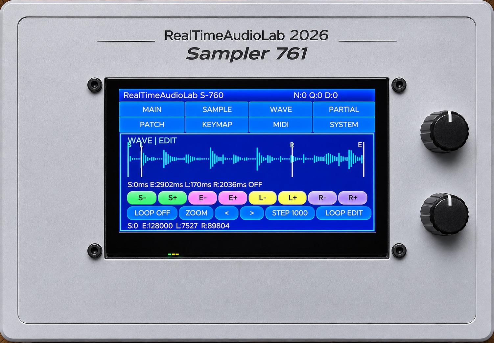
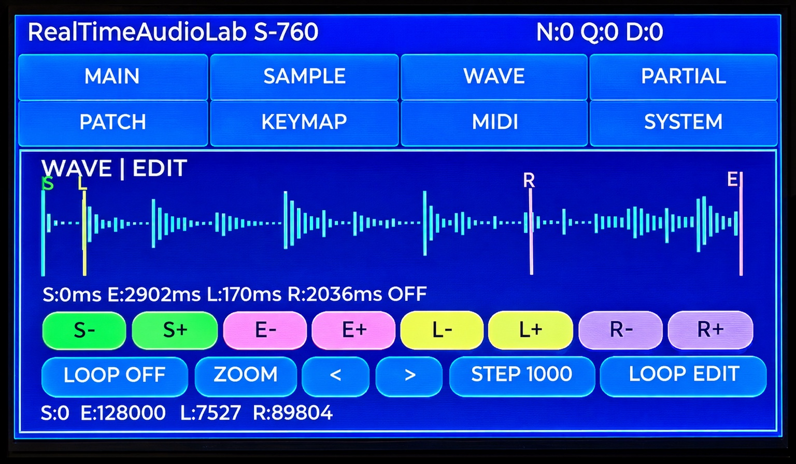

# RTAL-EAI-017-SoundSampler761

### RealTimeAudioLab · Eigenständiger Embedded-Sampler · 2026

**Inspiriert vom Roland S-760 – aber kein Nachbau, keine Firmware-Portierung und kein Roland-Produkt.**

> **PROJEKTVORSCHAU / IN ENTWICKLUNG** – Dieses Repository stellt das Projekt vor; es ist noch keine fertige Firmware-Veröffentlichung.

[English](README.md) · [Roadmap](docs/ROADMAP.md) · [Technik](docs/TECHNICAL_OVERVIEW.md) · [Entwicklungsstand](docs/DEVELOPMENT_STATUS.md)

## Die Idee

Mit **RTAL-EAI-017-SoundSampler761** entwickelt RealTimeAudioLab einen eigenständigen, kompakten Hardware-Sampler mit ESP32-S3, Touchscreen, SD-Speicher, MIDI und I²S-Audio. Die Bedienphilosophie klassischer Sampler, insbesondere des Roland S-760, dient als Inspiration. Hardware, Software und Bedienoberfläche werden eigenständig entwickelt.

## Bilder des Prototyps

| Hardware und Gehäuse | Wave-Editor auf dem Touchscreen |
|:--:|:--:|
|  |  |

Auf dem Gehäuse steht **Sampler 761**; die aktuelle Entwicklungsoberfläche trägt noch die Bezeichnung **RealTimeAudioLab S-760**. Die GUI-Bezeichnung kann in späteren Versionen angepasst werden.

## Auf Hardware bereits bestätigt

- Display und GT911-Touch funktionieren.
- SD-Zugriff und Laden einer Test-WAV-Datei funktionieren.
- Hörbare Audioausgabe über PCM5102A/I²S.
- MIDI-Noten und korrektes Note-Off in den durchgeführten Tests.
- Sechsstimmige Sample-Wiedergabe im Hardwaretest bestätigt.
- Wave-Editor-Oberfläche mit Markern für Start, Ende und Loop sowie Bearbeitungsbedienelementen vorhanden.
- In dokumentierten Testabschnitten: keine gemeldeten MIDI-Fehler, verlorenen Events oder Audio-Underruns; keine allgemeine Leistungsgarantie.

## Was SoundSampler761 können soll

| Bereich | Geplante Funktionen |
|---|---|
| Samples | WAV-Dateien laden, verwalten und organisieren |
| Wave Editor | Start/Ende, Loop-Punkte, Zoom, Navigation und Vorschau |
| Keymaps | Multisamples auf Tastaturzonen verteilen, Root-Notes und Tonbereiche |
| Patches | Spielbare Programme mit individuellen Parametern |
| MIDI | Keyboard-Steuerung, Programmwechsel und erweiterte MIDI-Funktionen |
| Sound Engine | Polyphone Wiedergabe, Hüllkurven und Qualitätsverbesserungen |
| Speicher | SD-basierte Ablage von Samples, Keymaps, Patches und Einstellungen |
| Touch-GUI | MAIN, SAMPLE, WAVE, PARTIAL, PATCH, KEYMAP, MIDI, SYSTEM |

**Wichtig:** Die Tabelle beschreibt Entwicklungsziele. Nicht jede Funktion ist bereits implementiert oder getestet.

## Entwicklungsphilosophie

Ein eigenständiges Musikinstrument, das die direkte, kreative Arbeit mit Samples in ein modernes Embedded-System überträgt. Die Entwicklungsfortschritte sollen nachvollziehbar dokumentiert werden. Firmware und Build-Anleitungen folgen erst mit einer dafür vorbereiteten Veröffentlichung.

## Rechtlicher Hinweis

**Roland** und **S-760** sind Bezeichnungen ihrer jeweiligen Rechteinhaber. Keine Verbindung, Lizenzierung oder Unterstützung durch Roland. Keine Verwendung proprietärer Roland-Firmware, ROMs oder Sample-Bibliotheken. Für dieses Teaser-Paket ist noch keine Softwarelizenz festgelegt; siehe [LEGAL.md](LEGAL.md).

**RealTimeAudioLab · SoundSampler761 · 2026**
